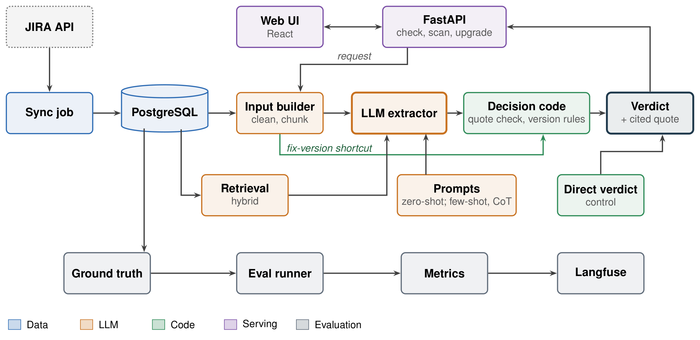

# snytch

Watches the issue trackers of your upstream dependencies for bugs that affect the exact version
you run: data loss, upgrade regressions, deadlocks and other bugs that never get a CVE.

## Idea and choices

**Problem.** A production deployment pins a dependency version (e.g. Kafka 3.9.1). Most bugs that
hurt it have no CVE and exist only as free text in the issue tracker, so knowing whether a new
issue affects my version means reading it and working out where the bug starts.

**What alternatives leave unresolved.** Snyk, Dependabot and Renovate only see CVEs and new
releases. JIRA's "affects version" is usually just the reporter's version. A general LLM compares
versions badly (`3.10.0` vs `3.9.0`) and guesses when the text doesn't say.

**Choices.**

- The LLM only extracts version facts from the issue, each with a verbatim quote; code checks
  the quote and decides `affected`, `not_affected` or `insufficient_information`.
- Inconclusive is a valid answer: a bug seen on 3.6.0 says nothing about 3.5.2, and a wrong
  "not affected" is a silent miss.
- JIRA fix versions are used as structured data; when they settle the answer, no model is called.
  Extracted facts are stored and reused for any version.

## Architecture



JIRA issues are synced into PostgreSQL. For a pinned version, the input builder cleans and
chunks the issue text; if the fix versions already settle the answer, code decides without a
model call. Otherwise the LLM extractor (`qwen/qwen3-4b-2507` by default) returns cited version
facts, and the decision code checks each quote and applies the version rules. The verdict goes
back through FastAPI to the web UI. The eval runs the same extractor and decision code over the
ground-truth set and records metrics in Langfuse, alongside the few-shot, chain-of-thought,
hybrid-retrieval and direct-verdict variants.

## Data

- **Apache JIRA issues** (`issues.apache.org`, public, read anonymously): text, comments, affected
  and fix versions. The text says where a bug starts; the fix versions say where it ends. Every
  answer shows the quote it came from and links to the issue.
- **Your repository's build files**, read in the browser, to find which dependencies and versions
  you run.

## Run locally

Requires [uv](https://docs.astral.sh/uv/), Docker, Node.js, and an OpenAI-compatible model
server (e.g. [LM Studio](https://lmstudio.ai/) serving `qwen/qwen3-4b-2507` on
`http://localhost:1234/v1`).

```bash
cp .env.example .env               # set DEP_WATCH_LLM_MODEL
uv sync
docker compose up -d --wait        # Postgres on localhost:5433
uv run dep-watch-agent             # API on 127.0.0.1:8000
```

Prepare the data (the first Kafka sync takes about 7 minutes; later syncs fetch only changes):

```bash
curl -XPOST localhost:8000/sync/jira -H 'content-type: application/json' -d '{"project": "KAFKA"}'
```

Start the web UI:

```bash
cd frontend
npm install
npm run dev                        # http://localhost:5173
```

## Demo path

**Situation.** I run Kafka 3.9.1 and want to know which recent upstream bugs affect it.

**Action.** On **Scan**, pick the repository folder and tick Apache Kafka 3.9.1 (or open
`http://localhost:5173/?dependency=kafka&version=3.9.1`), sync, then scan issues since a date.

**Expected result.** Each issue is answered Affected, Not affected or Inconclusive for 3.9.1, with
the quote it was decided from and a link to JIRA. For example:

- [KAFKA-20959](https://issues.apache.org/jira/browse/KAFKA-20959): **Affected**, the text says it
  affects "versions 3.2.1 and up" and it has no fix version.
- [KAFKA-21033](https://issues.apache.org/jira/browse/KAFKA-21033) ("Regression in backoff
  algorithm"): **Not affected**, the text says the change came in 4.3.0.

On **Upgrade**, comparing 3.9.1 with a target version shows which bugs the upgrade fixes and
which it newly exposes.

## Status

**Works now:** JIRA sync (Kafka, Spark, Hadoop and other Apache projects), repository scan,
alerting scan and single-issue check for Kafka and Spark (experimental), upgrade comparison, web UI.


## Development

```bash
uv run pytest                    # run tests (DB tests skip if Postgres is down)
uv run ruff check .              # lint
uv run ruff format .             # format
```

Interactive API docs are at http://127.0.0.1:8000/docs and the OpenAPI schema at `/openapi.json`
(generate a typed frontend client from it). During development, run
`uv run uvicorn dep_watch_agent.api.app:create_app --factory --reload`.

Set `DATABASE_URL` to use a different Postgres, and `DEP_WATCH_CORS_ORIGINS` to the frontend's
origin (see `.env.example`). Tests use
`TEST_DATABASE_URL` if set, and each test runs in its own throwaway schema.

### Web UI

`frontend/` is a React + TypeScript app (Vite) over the API. It starts by asking for your
repository folder: the browser reads its build files (Maven `pom.xml` with properties, Gradle
build files, lockfile and version catalog, sbt, Python requirements, `pyproject.toml` and
locks, npm `package.json` with its lock, CycloneDX SBOMs, images in Compose files and
Dockerfiles), skipping hidden and generated folders, and sends only their text to
`POST /repo/scan`, which lists every dependency and version found. Confluent Platform's
`cp-kafka` x.y.0 images count as the Apache Kafka release they ship.
You tick the ones to watch; every dependency is shown, but only Kafka and (experimental) Spark
can be watched for now. A version can also be added by hand, and changing the repository can be
abandoned (Keep watching, Cancel, or Esc) without losing what is watched.

Pages follow the flow:

- **Scan** (`#/scan`): 1 choose the repository, 2 sync the watched dependencies, with what a
  scan would still read per dependency, 3 scan upstream bugs for the watched version, 4 the
  results: answer counts that filter the list, bugs by day, where the bugs were seen, and each
  issue with its version ruler and quoted evidence.
- **Upgrade** (`#/upgrade`): compare two versions: what is fixed, what newly affects you.
- **Dashboard** (`#/dashboard`): statistics from the database: issues by source, then for the
  source picked bug counts, bugs filed and fixed per month, and every issue. For an answered
  dependency an issue also shows whether it affects your version, from fix versions or stored
  facts, or read on request.
- **Sources** (`#/sources`): pick an issue tracker, sync it, see what is new in it.
- **Models** (`#/operations`): models, reading time, jobs. Eval results are in Langfuse.

Old links (`#/alerts`, `#/setup`, `#/issues/KEY`, `#/check/KEY`) are rewritten to the new pages.

```bash
cd frontend
npm install
npm run dev        # http://localhost:5173, proxies /api to the API on :8000
npm run gen:api    # regenerate src/api/schema.ts from /openapi.json after changing schemas.py
npm run build      # type-check and build to dist/
```

The choice is kept in the browser; a link with `?dependency=kafka&version=3.9.1` opens on that
version without a repository.

### Schema migrations

The schema is defined once, as SQLAlchemy models in `src/dep_watch_agent/orm.py`. Migrations
are [Alembic](https://alembic.sqlalchemy.org/) revisions in
`src/dep_watch_agent/migrations/versions/`, autogenerated from the models. To change the
schema, edit the models, then generate and review a revision:

```bash
uv run alembic revision --autogenerate -m "add foo table"  # always read the generated file
uv run alembic check                         # models and database agree?
uv run alembic upgrade head                  # the API also runs this on startup
uv run alembic downgrade -1                  # undo the latest revision
uv run alembic history                       # list revisions
```

Autogenerate can't see everything (check constraints, some server defaults, data
migrations); add those by hand with `op.execute`. Every revision must have a working
`downgrade()`; the test suite upgrades and downgrades each one, and fails if the models and
migrations disagree. If two branches both add a revision, merge the heads (`uv run alembic merge heads`)
before landing; a test fails when there is more than one head.

### JIRA sync

`POST /sync/jira` starts a background job that pulls issues with their affected versions, fix versions, components and comments
from `issues.apache.org` anonymously. The first run fetches all ~20k KAFKA issues (about
7 minutes with the default 1 s delay between requests); later runs fetch only issues updated
since the previous run. Send `{"project": "KAFKA", "full": true}` to re-sync everything. Poll `GET /jobs/{id}` for
progress (issues synced so far) and the result; `GET /sync/state` shows the watermark.

```bash
curl -XPOST localhost:8000/sync/jira -H 'content-type: application/json' -d '{"project": "KAFKA"}'
```

### The LLM system

The system that reads issue text is an open model behind an OpenAI-compatible server. With LM
Studio, load a model, start its server (default `http://localhost:1234/v1`) and set in `.env`:

```bash
DEP_WATCH_LLM_MODEL=qwen/qwen3-4b-2507   # the model id the server lists at /v1/models
```

It is registered as `qwen3-4b-2507` (override with `DEP_WATCH_LLM_SYSTEM`). Without a model,
`/check` and `/scan` return 503. The prompt is `src/dep_watch_agent/llm/prompts/extract_facts.md`.
The model answers in text and the JSON is parsed out of it: reasoning models such as gemma-4
skip their thinking under schema-constrained decoding and then find no facts at all
(`DEP_WATCH_LLM_OUTPUT=json_schema` turns constraints on for models that don't reason). Invalid
output is retried, then counts as no facts.
Issues longer than one chunk (30k characters) are read in chunks, up to six. Calls are traced to
Langfuse when its keys are set.

On AWS the same system runs on Amazon Bedrock: set `DEP_WATCH_LLM_PROVIDER=bedrock`, `AWS_REGION`
and a Bedrock model id in `DEP_WATCH_LLM_MODEL`. Credentials come from the AWS chain (an SSO
profile locally, the instance role on EC2), so no API key is stored. Bedrock reads in `text` mode
only.

### Checking an issue

```bash
curl -XPOST localhost:8000/check -H 'content-type: application/json' \
  -d '{"issue_key": "KAFKA-15417", "version": "3.5.1"}'
```

The answer is `affected`, `not_affected` or `insufficient_information`, with the cited facts it
used, the facts it rejected (and why), and a link to the issue. The system sees what it sees in
the eval: issue text without bot comments, plus JIRA's fix versions. If the fix versions alone
put the version past the fix, the answer is `not_affected` without a model call
(`decided_by: "fix_versions"`). Pass `"system"` to pick one; the default is the first registered.

### Scanning for a version

```bash
curl -XPOST localhost:8000/scan -H 'content-type: application/json' \
  -d '{"project": "KAFKA", "version": "3.9.1", "since": "2026-09-27T00:00:00Z", "limit": 200}'
```

A background job answers every candidate issue for the version: bugs (not duplicates, invalid
or not-a-bug), updated since `since`, newest first, at most `limit`. Poll `GET /jobs/{id}`; the
result lists affected issues first, then `insufficient_information`, then `not_affected`, each
with cited facts and a link. An issue that fails (e.g. the model server is down) is reported
with its `error`, not dropped. Each issue the fix versions don't settle costs one model call
(30–90 s on a laptop with a reasoning model), so scan this week's issues with `since`; a whole
version is ~3k issues.

The facts a system extracts don't depend on the version asked about, so they are stored in
Postgres (`extractions`, keyed by issue, system, extractor version and a hash of the text the
system sees) and committed per issue. Scanning again, scanning another version, or `/check`
reuse them without a model call (`cached: true`); a new comment, a new fix version, another
model or an edited prompt extracts again. Eval runs don't use stored facts, so they always
measure the system as it is.

## Evaluation

The ground-truth set lives in `eval/datasets/<name>/` and is committed to git. Each case asks:
is this Kafka version affected by this fixed issue?

**Design v2** (`kafka-ground-truth-v2`, the default) mirrors production. The system is given the
issue text and the **fix versions** (structured data from JIRA, later git), but not JIRA's
affected versions, which are usually just the reporter's version. What the text must supply is
where the bug starts:

- `affected` cases: a version JIRA lists as affected. Answerable if the text shows the bug at or
  before it ("reproduced on", stack traces, "since X").
- `not_affected` cases: the release just before JIRA's earliest affected version. Answerable
  only if the text shows the bug hadn't started ("introduced in X", "works on X"). "Seen on
  3.6.0" says nothing about 3.5.2.

A person (or, for v2, Claude; see `manifest.json` → `labels`) marks each case answerable from
the text or not; if not, the expected answer is `insufficient_information`. Design v1
(`kafka-ground-truth-v1`, fix versions masked) is kept for reference: the text named the fix
release in only ~4% of not-affected cases, so it couldn't tell systems apart.

`kafka-ground-truth-v3` is a held-out v2 set: 100 other issues (`exclude` lists every v1 and v2
issue), the same strata, labeled the same way. Rules and prompts were tuned on v2 errors, so
report final numbers on v3, and don't read its errors while tuning.

| Endpoint | Does |
|---|---|
| `POST /eval/datasets` `{"name": ...}` | sample 100 issues -> 200 cases (`design` v2 default; `exclude` issue keys for a held-out set) |
| `GET /eval/datasets/{name}/status` | labeling progress and problems |
| `POST /eval/datasets/{name}/upload` | push to the Langfuse dataset (needs `.env` keys) |
| `POST /eval/runs` `{"system": ...}` | score a system (needs labels) as a Langfuse experiment, saved locally too; a job |
| `POST /eval/runs` `{"system": ..., "langfuse": false}` | score locally only |
| `POST /eval/runs` `{"system": ..., "provisional": true}` | before labeling; local, not a result |
| `POST /eval/runs/{dataset}/{run}/langfuse` | record a saved local run as a Langfuse experiment, without calling the model |
| `GET /eval/runs`, `GET /eval/runs/{dataset}/{run}` | saved local runs and their results |

Every system extracts cited version facts from the issue text; `verdict.decide` drops facts
whose quote isn't in the text, then decides with the version module and the given fix
versions. Systems (models) are registered by name in `systems.SYSTEMS` and compared with each
other on the same metrics; there is no fixed baseline. Metric definitions are in
`eval/metrics.py`.

#### Variants

`DEP_WATCH_LLM_VARIANTS` (comma-separated, default `zeroshot`) registers one system per variant
of the configured model, named `<model>` for zero-shot and `<model>-<variant>` otherwise:

| Variant | System |
|---|---|
| `zeroshot` | `prompts/extract_facts.md` |
| `fewshot` | plus made-up worked examples (`extract_facts.fewshot.md`; never from the eval set) |
| `cot` | step-by-step reasoning in `<reasoning>` tags before the JSON (`extract_facts.cot.md`) |
| `hybrid` | zero-shot over hybrid retrieval on issues longer than `DEP_WATCH_RETRIEVAL_BUDGET` (6,000 characters): passages embedded with `DEP_WATCH_EMBED_MODEL` into pgvector, ranked by cosine distance and `ts_rank`, fused by reciprocal rank |
| `direct` | the direct-verdict control (RQ1): the model answers each version with one citation, code only checks the citation. Eval only; `/check` and `/scan` use the first other system |

#### What a run reports

Results are read in Langfuse, not in the web UI: each run is an experiment on the uploaded
dataset, with per-case `correct` and `citation_validity` scores, traces of every model call, and
the run-level scores below. Upload the dataset again after labels or `issue_dates.json` change
(`POST /eval/datasets/{name}/upload`; items are updated in place). The saved local file is what
the gate and the comparison report read.

Each run has the metrics (macro-F1, silent-miss and false-alarm rates, abstention recall,
citation validity, latency p50/p95 per issue), a 95% bootstrap interval for each rate metric
resampling issues (`eval/stats.py`; in the Langfuse score's comment), the gate result
(`gate_passed`) when its system has a baseline, and, when the dataset has `issue_dates.json` and
the model's release date is known (`eval/contamination.py`, or `DEP_WATCH_LLM_RELEASE_DATE`),
macro-F1 and accuracy on issues created before and after the release. Dataset items carry the
issue's `created` date in their metadata.

| Endpoint | Does |
|---|---|
| `GET /eval/compare?dataset=&a=&b=` | McNemar's exact test and paired bootstrap differences |
| `POST /eval/runs/{dataset}/{run}/baseline` | accept a run as its system's gate baseline |
| `POST /eval/runs/{dataset}/{run}/faithfulness` | judge-scored faithfulness (`DEP_WATCH_JUDGE_MODEL`, never the model under test) and context recall; a job |
| `POST /eval/datasets/{name}/dates` | write `issue_dates.json` from the synced issues |

The regression gate compares every run with its system's baseline in
`eval/baselines/<dataset>/<system>.json` (committed). There is no CI, so check a saved run from
the command line before merging a prompt or model change:

```bash
uv run python -m dep_watch_agent.eval.gate eval/runs/kafka-ground-truth-v2/<run>.json
```

It exits 1 when a gated metric is worse than the baseline by more than its tolerance. A side
by side report of several runs (intervals, McNemar against a reference, error kinds, the long
issues, the contamination split):

```bash
uv run python -m dep_watch_agent.eval.analysis eval/datasets/kafka-ground-truth-v2 eval/runs/kafka-ground-truth-v2/{a,b,c}.json
```

The full experiment matrix for the report runs from the command line on LM Studio, one model
loaded at a time, and takes several hours: a preflight (models downloaded, database migrated),
four models and their variants, judged faithfulness for the Qwen3-4B runs, every new run
recorded in Langfuse (the dataset is uploaded first), and the report above over every run, in
`eval/runs/<dataset>/report.md`:

```bash
scripts/eval/run_matrix.sh --check          # preflight only; prints how to get a missing model
scripts/eval/run_matrix.sh                  # every model; or name some: qwen/qwen3.5-9b
VARIANTS=hybrid scripts/eval/run_matrix.sh qwen/qwen3-4b-2507   # one variant again
scripts/eval/run_matrix.sh --report         # the report only, from the saved runs
```

Its steps also run alone: `scripts/eval/run_variants.py <model> <variants>` scores and saves
runs locally (`--limit N` for a smoke test), `scripts/eval/judge.py <run.json>...` adds judged
faithfulness, and `scripts/eval/replay.py [--upload] <run.json>...` records saved runs in
Langfuse.

Faithfulness is also scored by the RAGAS library itself, so the in-house judge can be checked
against it. RAGAS runs in an overlay environment rather than as a project dependency (its
`instructor` would hold `openai` back); the judge is any OpenAI-compatible API, set with the
`DEP_WATCH_RAGAS_*` variables in `.env.example`. `--limit 3` scores three issues without saving,
to check the judge answers in RAGAS's format first:

```bash
uv run --with ragas==0.4.4 python scripts/eval/ragas_judge.py eval/runs/kafka-ground-truth-v2/qwen3-4b-2507.json --limit 3
```

- `POST /eval/datasets` refuses (409) to overwrite an existing dataset, so labels aren't lost. To change the
  sample, create a new dataset name (e.g. `-v3`).
